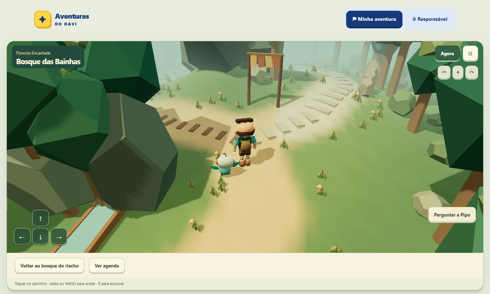
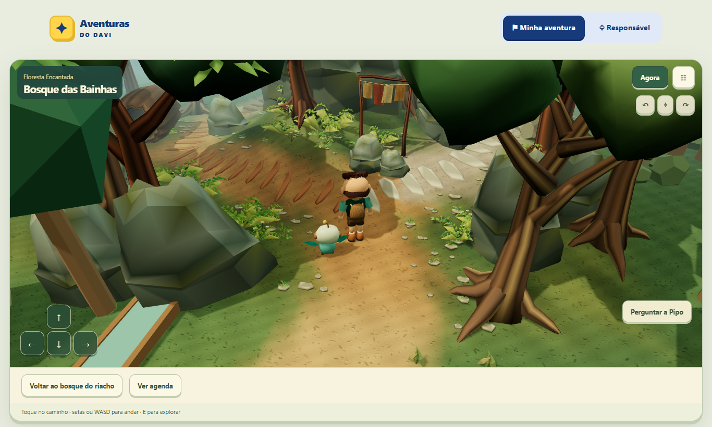

# Bosque das Bainhas · Cena-modelo da Etapa 5

Abra a Floresta Encantada e siga os barquinhos até o varal. A casca acompanha a margem baixa. As lajes claras sobem pelo outro lado. Para ver o besouro, siga a casca até o tronco oco, aproxime-se e vire a folha. A dupla olha para o abrigo quando para. A água muda de lado e o besouro carrega sua telha de folha para o novo canto. No vídeo, Davi sai para a garganta, volta pelas lajes e abre **Agora** no recanto. [Vídeo contínuo no jogo](besouro-1366-high.mp4)

## Referência, antes e depois

Na imagem original do responsável, o ocre do percurso se dissolve em cascalho e musgo, as frondes emolduram a passagem e o fundo perde contraste. Na Etapa 4B, placas regulares, árvores angulosas e uma superfície quase lisa deixavam o trecho uniforme. A cena-modelo traz barro marcado, bordas irregulares, raízes esculpidas, frondes, pedras em camadas e um fundo mais frio. O varal de tecido e a boca do tronco fazem o papel de marcos. A escala e a profundidade vertical do vale na imagem de referência permanecem maiores. No jogo, a abertura precisa enquadrar as duas escolhas em retrato e manter o besouro legível a partir do chão seguro. [Proposta e comparação com a referência original](../game-design/etapa5-direcao-bosque.md)

### A escolha entre casca e lajes

| Etapa 4B | Etapa 5 · Detalhado |
|---|---|
|  |  |

| Largura | Antes | Depois, detalhado | Depois, econômico |
|---|---|---|---|
| 360 px | [Etapa 4B](../evidencias-etapa4b/bifurcacao-360.png) | [Captura](bifurcacao-360-high.png) | [Captura](bifurcacao-360-low.png) |
| 390 px | [Etapa 4B](../evidencias-etapa4b/bifurcacao-390.png) | [Captura](bifurcacao-390-high.png) | [Captura](bifurcacao-390-low.png) |
| 1366 px | [Etapa 4B](../evidencias-etapa4b/bifurcacao-1366.png) | [Captura](bifurcacao-1366-high.png) | [Captura](bifurcacao-1366-low.png) |

### A consequência no recanto

| Largura | Antes com a folha virada | Depois, detalhado | Depois, econômico |
|---|---|---|---|
| 360 px | [Etapa 4B](../evidencias-etapa4b/abrigo-360.png) | [Encontro](encontro-360-high.png) · [Folha virada](abrigo-360-high.png) | [Encontro](encontro-360-low.png) · [Folha virada](abrigo-360-low.png) |
| 390 px | [Etapa 4B](../evidencias-etapa4b/abrigo-390.png) | [Encontro](encontro-390-high.png) · [Folha virada](abrigo-390-high.png) | [Encontro](encontro-390-low.png) · [Folha virada](abrigo-390-low.png) |
| 1366 px | [Etapa 4B](../evidencias-etapa4b/abrigo-1366.png) | [Encontro](encontro-1366-high.png) · [Folha virada](abrigo-1366-high.png) | [Encontro](encontro-1366-low.png) · [Folha virada](abrigo-1366-low.png) |

## Arte no navegador

O GLB de autoria própria reúne os perfis de carvalho e amieiro, a ardósia, as raízes, as frondes, o tronco oco e o varal. Os materiais usam pigmentos pintados por vértice e uma textura de solo produzida para o trecho. Ao instanciar os modelos, o jogo usa as mesmas curvas do percurso da Etapa 4B, assenta as peças do piso na inclinação do terreno e abre a linha de visão quando galhos ou copas cruzam a câmera. O brilho na carapaça, a forma dos olhos e os gestos das antenas distinguem o besouro. Davi e Pipo mantêm suas proporções e rigs. A nova pose de observação orienta a dupla para o recanto quando está parada.

O econômico conserva formas, marcos e contraste da água. Omite sombras dinâmicas, pontas adicionais da copa e parte da vegetação miúda. A arte do trecho usa as coordenadas do recanto existente. A ligação caminhável entre a clareira e a Soleira segue prevista no projeto de continuidade. [Modelos-fonte editáveis](../../assets/forest/bosque-authoring.blend) · [Gerador dos modelos](../../tools/forest/build_bosque.py) · [Pintura do solo](../../tools/forest/paint_bosque.py)

## Custo medido

Chromium com ANGLE/D3D11 e RTX 2060 SUPER, relação de pixels 1. Em cada posição, o ensaio analisou 36 intervalos consecutivos do renderizador e registrou o contador do Three.js. Os pares abaixo são chamadas de desenho e triângulos submetidos. O p95 resume os intervalos entre quadros nesses pontos. Ele reflete também a cadência da tela. O tempo até pronto começa ao abrir a trilha em loopback, com os personagens já carregados na clareira.

| Largura e perfil | Bifurcação | Recanto | Maior p95 dos dois pontos | Trilha pronta |
|---|---:|---:|---:|---:|
| 360 px · Detalhado | 125 / 203.676 | 143 / 202.746 | 16,8 ms | 883 ms |
| 360 px · Econômico | 56 / 89.604 | 75 / 89.466 | 16,7 ms | 588 ms |
| 390 px · Detalhado | 126 / 204.468 | 143 / 202.746 | 16,8 ms | 797 ms |
| 390 px · Econômico | 57 / 90.396 | 75 / 89.466 | 16,8 ms | 568 ms |
| 1366 px · Detalhado | 140 / 209.468 | 152 / 207.094 | 16,8 ms | 1.020 ms |
| 1366 px · Econômico | 71 / 95.396 | 84 / 93.814 | 16,8 ms | 674 ms |

No recanto de 390 px, o econômico submeteu cerca de **56% menos triângulos**. Os novos arquivos enviados ao navegador somam cerca de **408 KiB** em disco. O contador do jogo estimou **1,55 MiB** em buffers de geometria e instâncias e **3,42 MiB** em texturas da cena ativa. Os dois perfis carregam os mesmos modelos e alternam a visibilidade de detalhes. Esses valores se referem a recursos contabilizados pelo jogo, sem incluir toda a memória do navegador, do driver ou dos mapas de sombra. [360 detalhado](besouro-360-high.json) · [360 econômico](besouro-360-low.json) · [390 detalhado](besouro-390-high.json) · [390 econômico](besouro-390-low.json) · [1366 detalhado](besouro-1366-high.json) · [1366 econômico](besouro-1366-low.json)

## Regressões

Passaram 62 testes Python, quatro casos unitários de navegação e o percurso sintético nos dois perfis em 360, 390 e 1366 px. O navegador verificou os dois alvos na bifurcação com a câmera inicial. Em 1366 detalhado e 390 econômico, completou o circuito pela garganta e voltou à folha, abriu **Agora** e conferiu posição, saldo e ocorrência. Em 390 econômico, também recarregou, reverteu a folha com movimento reduzido e voltou pelo 2D. O ensaio separado de fallback WebGL passou. O GLB passou pelo validador Khronos sem erros nem avisos. [Ensaio reproduzível](../../tests/browser_shelter.cjs)

## Limites da revisão

As capturas são do jogo rodando em Chromium, com dados sintéticos em loopback. A leitura e o desempenho físicos no Fire HD 8 (2022), Redmi 8 e LG All in One continuam pendentes. O 2D preserva a rotina e a retomada da trilha. O besouro pertence à cena 3D desta amostra. A decisão artística cabe ao responsável. A pergunta desta rodada é se o varal e as duas entradas dão vontade de caminhar até o que está atrás da primeira curva.
