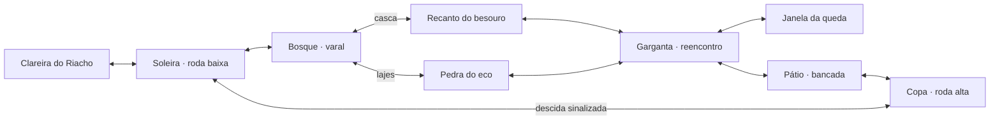

# Etapa 6 · A Floresta Encantada contínua

Saia da Clareira do Riacho pela margem das bandeiras azuis. A passagem chega à **Soleira da Roda Baixa**, onde um barquinho passa pela calha. No **Bosque das Bainhas**, siga a casca para investigar o besouro ou as lajes para encontrar o eco. Os dois trajetos chegam à **Garganta das Duas Margens**. Dali, siga o caminho livre por trás do mirante para a bancada do **Pátio dos Remendos**. A calha sobe até a **Copa da Nascente**, onde a roda alta apanha e solta as folhas. As bandeiras claras marcam a descida de volta à roda baixa. [Vídeo contínuo no Chromium](volta-1366-high.mp4)

A Clareira e a Soleira formam a primeira parada do circuito. O terreno tem uma junção caminhável. Os dois lados usam o mesmo avatar, caminho, câmera, renderizador e botão **Agora**. Os 1 min 46 s da gravação usam o mesmo canvas de jogo e começam com zero estrelas e inventário vazio. Por volta de 0:40, a dupla encontra o besouro, a 1:04 chega ao Pátio e a 1:12 chega à roda alta. O ensaio troca de vista depois da volta. [Revisão da direção](https://github.com/nellipe/davi-missoes/pull/17#issuecomment-6979975891)

## Capturas

| Lugar | 360 px econômico | 390 px econômico | 1366 px detalhado |
|---|---|---|---|
| Clareira | [Captura](clareira-360-low.png) | [Captura](clareira-390-low.png) | [Captura](clareira-1366-high.png) |
| Passagem da margem | [Captura](passagem-360-low.png) | [Captura](passagem-390-low.png) | [Captura](passagem-1366-high.png) |
| Soleira | [Captura](soleira-360-low.png) | [Captura](soleira-390-low.png) | [Captura](soleira-1366-high.png) |
| Bosque | [Captura](bosque-360-low.png) | [Captura](bosque-390-low.png) | [Captura](bosque-1366-high.png) |
| Recanto do besouro | [Captura](besouro-360-low.png) | [Captura](besouro-390-low.png) | [Captura](besouro-1366-high.png) |
| Garganta | [Captura](garganta-360-low.png) | [Captura](garganta-390-low.png) | [Captura](garganta-1366-high.png) |
| Pátio | [Captura](patio-360-low.png) | [Captura](patio-390-low.png) | [Captura](patio-1366-high.png) |
| Copa | [Captura](copa-360-low.png) | [Captura](copa-390-low.png) | [Captura](copa-1366-high.png) |
| Vista 2D | [Copa](mapa-2d-360-low.png) | [Copa](mapa-2d-390-low.png) | [Clareira](mapa-2d-1366-high.png) |

As capturas em retrato foram feitas no jogo a partir de pontos sintéticos salvos. Em cada largura, o ensaio também caminhou pela Copa em 2D e retomou a posição em 3D. O vídeo de 1366 px percorre o circuito pelo chão, por cliques e pelos controles existentes.

## Continuidade e progresso

- A rota da margem é pública em ambas as vistas. A ponte comprável continua servindo à travessia original para a casa e o baú. Oficina, diário, calendário, portal, personalização e os marcadores de atividades anteriores mantêm seus lugares. A bancada do Pátio dá acesso à mesma oficina e ao mesmo saldo.
- A Floresta salva um único ponto em coordenadas do mapa contínuo. Ao abrir uma instalação com dados anteriores, a retomada usa o ponto da clareira ou traduz as coordenadas da antiga trilha se este era o último lugar escolhido no aparelho. O servidor confere o terreno e a disponibilidade da ponte. O formato do SQLite foi preservado.
- Pipo acompanha Davi com as mesmas animações e reage brevemente na chegada a uma nova região e no recanto. A folha do besouro persiste. O eco, o mirante, as peças de madeira do Pátio e as rodas podem ser visitados novamente. Explorar mantém saldo e confirmações da agenda.
- **Agora** permanece no topo em 2D e 3D. A mesma lista de atividades e o mesmo sistema de janelas do servidor atendem Aprender, Fazer e Lembrar. O acesso à Ilha das Ideias continua nas opções como outro mundo existente. A vista 2D da Floresta usa os caminhos e os pontos do mapa contínuo.

O Bosque usa a arte aprovada na Etapa 5B. As áreas seguintes reutilizam os modelos de folhas, raízes, rochas e frondes com paletas e composições locais. A Soleira tem panos azuis e madeira clara, a Garganta usa pedra fria e a janela da queda, o Pátio tem tons de barro e tecido roxo e a Copa abre o céu sobre a roda alta. Cenário próximo é desenhado por grupos. Os modelos da trilha começam a carregar ao se aproximar da margem. O econômico conserva o percurso e os marcos, com menos folhagem e sombras dinâmicas desligadas. [Arte e legibilidade da Etapa 5B](../evidencias-etapa5b/README.md)

## Desempenho e limites

Os pares são chamadas de desenho e triângulos registrados pelo Three.js em Chromium com RTX 2060 SUPER, ANGLE/D3D11. O p95 dos 30 intervalos amostrados por ponto ficou entre 16,7 e 16,8 ms. As contagens dependem da câmera. Na passagem e no recanto, ainda podem entrar grupos dos dois lados do vale. São os primeiros pontos para verificar em aparelhos físicos.

| Região ou passagem | 1366 detalhado | 1366 econômico | 390 econômico |
|---|---:|---:|---:|
| Clareira | 180 / 322.634 | 76 / 143.473 | 63 / 130.530 |
| Passagem | 278 / 519.580 | 152 / 241.545 | 112 / 218.026 |
| Soleira | 177 / 274.474 | 106 / 145.988 | 85 / 100.730 |
| Bosque | 159 / 285.382 | 92 / 155.812 | 64 / 141.674 |
| Recanto do besouro | 269 / 520.987 | 147 / 248.360 | 112 / 212.684 |
| Garganta | 208 / 517.877 | 48 / 131.940 | 42 / 109.458 |
| Pátio | 147 / 294.464 | 74 / 162.834 | 70 / 145.560 |
| Copa | 178 / 291.732 | 108 / 165.038 | 83 / 124.584 |

[1366 detalhado](regioes-1366-high.json) · [1366 econômico](regioes-1366-low.json) · [390 econômico](regioes-390-low.json) · [360 econômico](regioes-360-low.json)

As medições e capturas usaram dados sintéticos em loopback. Emulação de tamanho e toque permite verificar composição e navegação. Fire HD 8 (2022), Redmi 8 e LG All in One de terceira geração continuam pendentes de ensaio físico. A avaliação de interesse, orientação espontânea e vontade de revisitar também depende da família.

## Regressões

Passaram 63 testes Python, incluindo horários, sessão e posição persistida, e quatro casos unitários de navegação. O navegador verificou clique, toque e teclado, a travessia da margem sem inventário, a volta pela descida da Copa, a persistência após recarga, Agora, fallback WebGL e contatos com rocha, árvore, margem e ponte. Passaram 30 ciclos entre 2D e 3D, com retomada de posição, o direcional antigo encerrado e verificação de nós e listeners após coleta. [Registro das 60 transições](alternancias.json)

Um percurso sintético separado visitou dez destinos que já existiam. Incluiu uma atividade com roteiro, uma sem roteiro, compras de ponte, casa e portal, a travessia da ponte e o equipamento de Pipo persistido. [Compras e missões no navegador](missoes-e-compras.mp4) · [Registro do percurso](missoes-e-compras.json) · [Contatos](contatos.json) · [Fallback](fallback.json)
