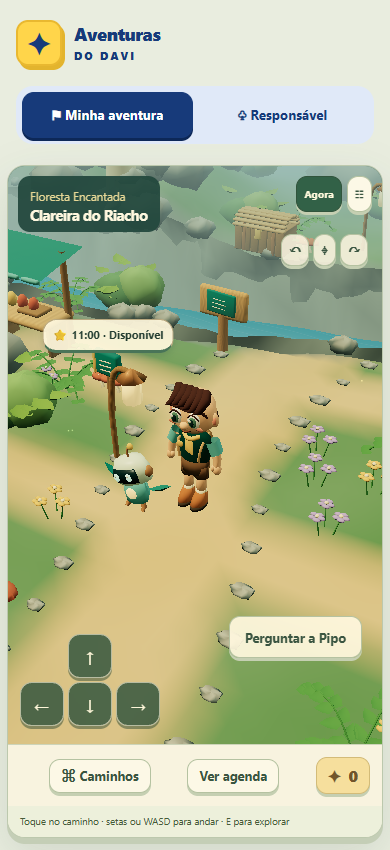
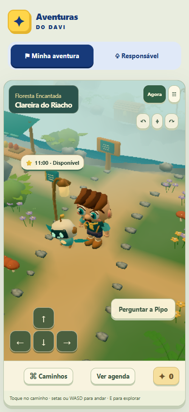
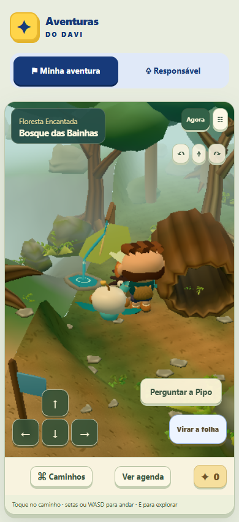

# Etapa 7 · Floresta Encantada Cartoon Chibi 3D

Davi ganhou uma cabeça maior, olhos em relevo, cabelo esculpido e botinas mais arredondadas. Pipo manteve a antena e as barbatanas, com um visor maior e um corpo de cerâmica mais compacto. A referência do responsável orientou as proporções e o acabamento suave de brinquedo. As silhuetas, o figurino, os materiais e o cenário são próprios de Aventuras do Davi.

O tratamento se estende às copas, troncos, pedras, caminhos, ponte, casa, bancada e roda alta. As duas texturas de trilha continuam identificáveis pela casca e pelas lajes. No recanto, o besouro tem olhos, marcas na carapaça e passos animados. O desvio da água muda a poça e o lugar onde ele se abriga. A produção dos modelos é reproduzível e inclui as cenas editáveis do Blender. [Fontes e licenças](../../assets/forest/README.md)

## Gameplay e capturas

- [Volta contínua no jogo · MP4](volta-1366-high.mp4) e [registro dos marcos](volta-1366-high.json). A caminhada sai da Clareira, cruza a Soleira, passa pela bifurcação e pelo recanto, segue pela Garganta e pelo Pátio e chega à Copa. A descida retorna à margem pelo mesmo cenário. O final abre **Agora**, recarrega e retoma a posição em 2D e novamente em 3D.
- [Missões, compras e outra margem · MP4](missoes-e-compras.mp4). [Ponte e casa compradas](outra-margem.png) · [Missão guiada](missao.png)

| Largura CSS e perfil | Antes · Etapa 6 | Depois · Etapa 7 |
|---|---|---|
| 360 px · Econômico | [Clareira](../evidencias-etapa6/clareira-360-low.png) · [Bifurcação](../evidencias-etapa6/bosque-360-low.png) · [Recanto](../evidencias-etapa6/besouro-360-low.png) | [Clareira](clareira-360-low.png) · [Bifurcação](bosque-360-low.png) · [Recanto](besouro-360-low.png) · [Poça após a interação](besouro-depois-360-low.png) |
| 390 px · Econômico | [Clareira](../evidencias-etapa6/clareira-390-low.png) · [Bifurcação](../evidencias-etapa6/bosque-390-low.png) · [Recanto](../evidencias-etapa6/besouro-390-low.png) | [Clareira](clareira-390-low.png) · [Bifurcação](bosque-390-low.png) · [Recanto](besouro-390-low.png) · [Poça após a interação](besouro-depois-390-low.png) |
| 1366 px · Detalhado | [Clareira](../evidencias-etapa6/clareira-1366-high.png) · [Bifurcação](../evidencias-etapa6/bosque-1366-high.png) · [Recanto](../evidencias-etapa6/besouro-1366-high.png) | [Clareira](clareira-1366-high.png) · [Bifurcação](bosque-1366-high.png) · [Recanto](besouro-1366-high.png) · [Poça após a interação](besouro-depois-1366-high.png) |

[Passagem](passagem-1366-high.png) · [Soleira](soleira-1366-high.png) · [Garganta](garganta-1366-high.png) · [Pátio](patio-1366-high.png) · [Copa](copa-1366-high.png) · [Retorno](retorno-1366-high.png) · [Mapa 2D](mapa-2d-1366-high.png). No Econômico em 390 px, [Pátio](patio-390-low.png) e [Copa](copa-390-low.png) mostram Davi em terreno aberto com as referências do local enquadradas.

| 390 px | Etapa 6 | Etapa 7 |
|---|---|---|
| Davi e Pipo na Clareira |  |  |
| Recanto após virar a folha | [Vista anterior do recanto](../evidencias-etapa6/besouro-390-low.png) |  |

Em 390 px, compare também a [bifurcação em Econômico](bosque-390-low.png) e a [mesma posição em Detalhado](bosque-390-high.png). O Econômico mantém o chão, o besouro, a água, os destinos e os personagens. Reduz a complexidade das copas e rochas, a resolução interna e as sombras dinâmicas.

## Desempenho e método

Na Etapa 6, os grupos da clareira e da trilha continuavam concorrendo no recanto. Na Etapa 7, o terreno da margem fica disponível enquanto as construções e a vegetação da clareira saem do desenho quando a posição e a direção da câmera dispensam sua presença. Nas demais regiões, conjuntos de vegetação compartilham materiais e geometrias, a variante econômica usa copas de menor complexidade e os conjuntos fora do trecho ativo são ocultados. As texturas principais passaram de 256 para 128 px. O recanto compartilha superfícies repetidas e anima as seis patas em uma única chamada. A trilha continua carregando por aproximação. Os contadores incluem as passagens de sombra quando ativas.

[Tabela antes/depois de todas as regiões, perfis e larguras](desempenho.md)

Chromium automatizado no Windows com RTX 2060 SUPER via ANGLE/D3D11, duas bases SQLite sintéticas e servidor em loopback. Mesmos pontos de salvamento e largura CSS, com uma abertura de cena por ponto. O FPS e os tempos de quadro vêm dos últimos 30 quadros da amostra após a abertura. A coluna **Abertura** da tabela mede da chamada de montagem à cena pronta, incluindo os modelos necessários naquele ponto. **GLBs iniciais** mede o primeiro grupo de modelos na mesma montagem. O tempo de abertura varia com as condições do host. A memória inclui bytes aproximados de buffers e texturas residentes da cena, inclusive o que fica pronto para retorno, e exclui o custo total do navegador e do driver.

Os dados de desktop ficaram em torno do teto de 60 FPS da captura. As passagens críticas enviam menos geometria por quadro, e o tamanho dos GLBs diminuiu. Os tempos de primeira abertura oscilam e os resultados de FPS, retomada de contexto e autonomia nos três aparelhos físicos dependem do teste da família.

Para repetir em uma cópia de desenvolvimento com Python, Playwright, Chromium e FFmpeg disponíveis, execute `node tests/browser_forest_continuous.cjs 1366`. Para as amostras por região, use `FOREST_REGION_STILLS=1`, `FOREST_PROFILE=low` ou `high`, e passe `360`, `390` ou `1366` no comando. Defina `FOREST_EVIDENCE_DIR` para gravar os arquivos em uma pasta separada. A medição de referência usa o commit `b43579e` em outro checkout com a mesma versão do script de captura.

## Regressões verificadas

| Ensaio | Resultado |
|---|---|
| Backend e agenda | 64 testes Python, incluindo permissões, horários de servidor, regras de economia, persistência e acesso ao diagnóstico |
| Navegação | 4 testes Node e [colisões e apoio na ponte, margem, rocha e árvore](contatos.json) |
| Remontagem, controles e estado | [30 ciclos, 60 trocas](alternancias.json), clique, toque, teclado, ação de toque cancelada, apoio dos pés e desmontagem de controles |
| Continuidade | [Mesmo canvas durante a volta](volta-1366-high.json), Pipo acompanha, mudança da poça persiste, posição recuperada após a missão, recarga e troca para 2D |
| Toque no Bosque | [Trilha das lajes até a Garganta e retorno de Agora](lajes-toque.json). [Revisita ao besouro, movimento reduzido e economia preservada](recanto-toque.json) |
| Destinos e construções | [Dez destinos e registros de compra](percurso.json), incluindo atividade com e sem roteiro e tentativa de concluir atividade antes da janela recusada com HTTP 409 |
| Perda de WebGL | [Recuperação, fallback automático e retomada](fallback.json), sem WebGL a agenda permanece disponível em 2D |
| Diagnóstico | Acesso infantil recusado, sessão do responsável mede o 3D, exporta JSON e encerra a coleta |
| Exportação de arte | [Sete GLBs validados](../../assets/forest/validation.json), zero erros com avisos do exportador registrados |

## Piloto familiar

[Publicação após aprovação, backup, rollback e roteiro para Fire HD 8, Redmi 8 e LG All in One](../publicacao-piloto-etapa7.md). A avaliação artística deve considerar a diferença de silhueta e acabamento, a leitura dos dois caminhos e se Davi quer explorar mais. Os testes automatizados registram estabilidade e desempenho no ambiente descrito.
