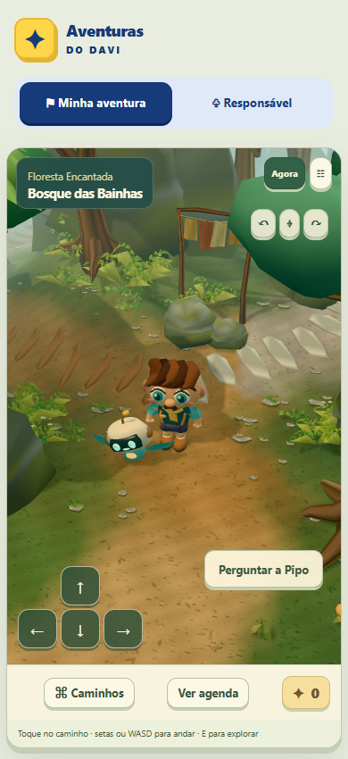
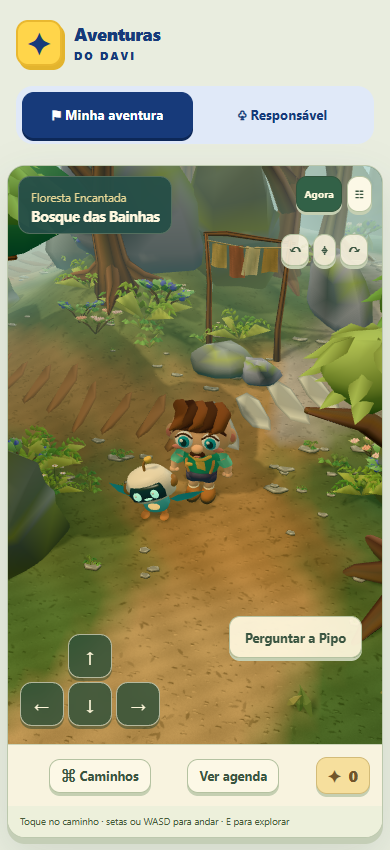

# Etapa 7B · Refinamento da Floresta Encantada

Revisão de desenvolvimento da versão `0.7B-chibi.2` sobre `05d4904`. As gravações são do jogo no Chromium, com dois bancos SQLite sintéticos e servidor em loopback.

## O que a reprodução mostrou

| Relato | Confirmação na base e correção |
|---|---|
| Rodas e barquinhos parados | Com as animações ativadas, as rodas baixa e alta giravam e o barco da Soleira avançava. No modo reduzido, apertar **Soltar um barquinho** mantinha o barco no mesmo ponto. A sequência agora mostra a folha no início, seu percurso e a chegada. O modo reduzido mostra dois estados claros e mantém a chegada visível. [Sonda da base](base-comportamento.json) · [Transformações medidas](movimento-390.json) |
| Pipo parecia deslizar | O clip Walk existia e movia as patas. O acompanhamento chegava ao limite de distância em plena caminhada e alternava Walk e Hover. Agora Pipo mantém o passo enquanto acompanha Davi e desacelera até parar. As botas maiores e a passada alternada deixam cada apoio legível. [Amostras da base](base-passos-pipo.json) · [Amostras da nova caminhada](movimento-390.json) |
| Menta, Sol e Azul quase iguais | A API salvava a escolha e o material mudava de cor. O pigmento era multiplicado pelo azul da textura `Teal`, as mangas mantinham outra cor fixa e o suporte do guarda-roupa cobria parte do personagem. Túnica neutra e mangas próprias recebem as três cores. A prévia e a cena aplicam a mesma escolha, e o mapa usa a mesma paleta. [Pixels da prévia e da roupa na cena](personalizacao-390.json) |
| Vestir e Tirar pouco perceptíveis | Os nós do chapéu, capa e lenço mudavam de visibilidade na base. O chapéu já aparecia sob ângulo favorável. A capa e o lenço tinham pouco volume em relação à mochila e ao casco. A nova capa envolve os ombros, o chapéu tem faixa, e o lenço tem nó e pontas destacadas. A prévia mostra frente e costas e o item indica **Em uso** ou **Na mochila**. [Pixels de cada item, persistência e 2D](personalizacao-390.json) |

Em um perfil de navegador novo, as animações começam ativadas. A escolha explícita fica guardada no navegador, inclusive se veio do controle antigo. Quando o aparelho solicita movimento reduzido, o jogo mostra esse estado no cenário e identifica a origem nas opções. O teste alterna a preferência do aparelho com o jogo aberto, reabre uma sessão com a escolha antiga e inicia outra sessão com preferências limpas.

## Vídeos curtos do navegador

- [Pipo andando, rodas, barquinhos e movimento reduzido](movimento-390.mp4). O começo mostra Davi e Pipo na Clareira. A gravação segue para Soleira e Copa e repete a liberação no modo reduzido, incluindo o mapa 2D.
- [Menta, Sol, Azul e Vestir/Tirar](personalizacao-390.mp4). A túnica muda na prévia e na Clareira. O chapéu, a capa e o lenço são comprados com estrelas sintéticas e depois vestidos e retirados. O final mostra 2D e retorno ao 3D.
- [Câmera e arte em cinco pontos da Floresta](camera-1366.mp4). Mostra dois ângulos em cada ponto, com recortes diretos da aplicação.

## Arte e enquadramento

A Aveleira acrescenta tronco inclinado e ramificação mais baixa. Seixos arredondados, pedras fendidas e ardósia alternam silhuetas, escala, musgo e pigmentos. Mirtilos arredondados, azaleias e samambaias substituem parte dos carimbos repetidos junto às trilhas. O Econômico mantém as diferenças principais. O Detalhado acrescenta ramos de copa, folhagem e flores. Os modelos usam geometrias compartilhadas e pigmentos por vértice. [Fontes editáveis e pipeline Blender](../../assets/forest/README.md)

| Largura CSS | Econômico | Detalhado |
|---|---|---|
| 360 px | [Antes](base-bosque-360-low.png) · [Depois](bosque-360-low.png) | [Antes](base-bosque-360-high.png) · [Depois](bosque-360-high.png) |
| 390 px | [Antes](base-bosque-390-low.png) · [Depois](bosque-390-low.png) | [Antes](base-bosque-390-high.png) · [Depois](bosque-390-high.png) |
| 1366 px | [Antes](base-bosque-1366-low.png) · [Depois](bosque-1366-low.png) | [Antes](base-bosque-1366-high.png) · [Depois](bosque-1366-high.png) |

| Bosque em 390 px, Detalhado | Antes | Depois |
|---|---|---|
| Bifurcação |  |  |

[Pátio antes](base-patio-390-low.png) · [Pátio depois](patio-390-low.png) · [Clareira e roupa Azul](personalizacao-390-sky-mundo.png) · [Capa vista pelas costas](personalizacao-390-cape-vestido.png) · [Personalização no mapa 2D](personalizacao-390-mapa-2d.png)

A câmera usa linhas de visão para Davi e Pipo. Só os elementos que cruzam essas linhas cedem espaço. Os ensaios de [360 px](camera-360.json), [390 px](camera-390.json) e [1366 px](camera-1366.json) verificaram cinco pontos, dois ângulos por ponto e pelo menos dois pontos visíveis de cada personagem no enquadramento.

## Regressões e custo gráfico

- [Métricas antes/depois](desempenho.md) em cada região, nos dois perfis e nas três larguras. A comparação foi feita em Chromium com RTX 2060 SUPER. O Fire HD 8, Redmi 8 e LG All in One ainda precisam medir a fluidez desta versão.
- 64 testes Python e quatro de navegação. O navegador também exercitou [30 ciclos 2D/3D](alternancias.json), [fallback e recuperação WebGL](fallback.json), [colisões e apoio](contatos.json) e [dez destinos e horários](percurso.json).
- [Volta contínua](volta-1366-high.json), [lajes por toque](lajes-toque.json) e [revisita à descoberta em movimento reduzido](recanto-toque.json). Os ensaios conferiram as rotas, a missão pelo botão Agora, a posição após o retorno, as construções, o inventário e a confirmação regulada pelo servidor.
- [Sete GLBs sem erros de validação](../../assets/forest/validation.json). Os avisos de exportação do rig e do cenário estão no relatório.

Para reproduzir o ensaio dirigido, use `node tests/browser_forest_refinement.cjs movimento 390`, `personalizacao 390` ou `camera 1366` com Playwright e Chromium. `FOREST_EVIDENCE_DIR` define a saída e `FOREST_RECORD=1` gera MP4 com FFmpeg.
