# Etapa 9.1 · Mundos vivos

As comparações mostram a versão revisada da Etapa 9 à esquerda e a Etapa 9.1 à direita. As gravações começam na entrada dos mapas. Os percursos incluem desvios, os três achados, o desfecho e o retorno ao ponto salvo após uma visita à Ilha das Ideias. As caminhadas foram aceleradas na edição. O desfecho aparece em velocidade normal.

| Mundo | Vídeo desktop | Vídeo móvel | Vista 2D |
| --- | --- | --- | --- |
| Praia dos Tesouros | [Da enseada ao baú](praia-desktop.mp4) | [Da enseada ao baú](praia-mobile.mp4) | [Enseada em 2D](praia-2d.jpg) |
| Vale dos Dinossauros | [Do Trico ao esqueleto](dinossauros-desktop.mp4) | [Do Trico ao esqueleto](dinossauros-mobile.mp4) | [Pátio em 2D](dinossauros-2d.jpg) |
| Cidade dos Inventores | [Da praça ao autômato](inventores-desktop.mp4) | [Da praça ao autômato](inventores-mobile.mp4) | [Estação em 2D](inventores-2d.jpg) |

Os vídeos foram capturados no Chromium com um banco SQLite descartável. O desktop usou 1366 × 820 e o móvel emulado usou 390 × 844. As capturas 2D também verificam a interface a 360 px e a preferência de movimento reduzido.

Os vídeos desktop da Praia e do Vale registram a posição anterior do balão do Pipo. As capturas de desfecho mostram a posição final do aviso.

## Entradas dos mapas

| Mundo | Etapa 9 | Etapa 9.1 |
| --- | --- | --- |
| Praia | 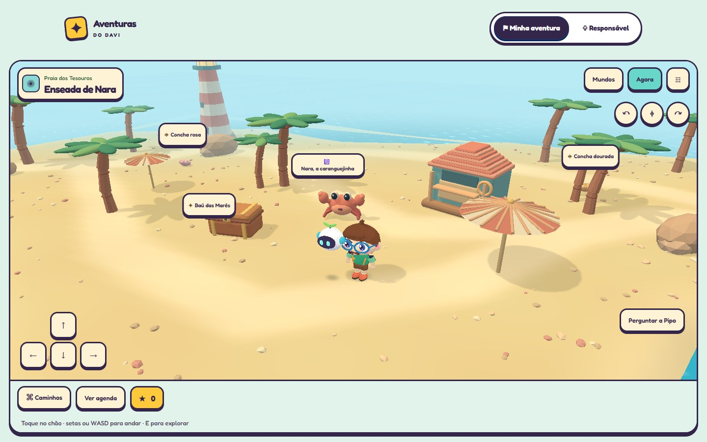 | 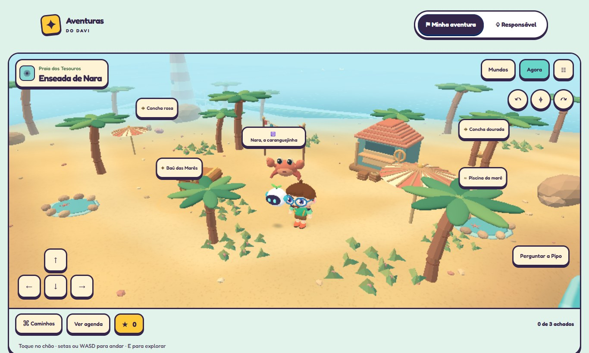 |
| Vale | 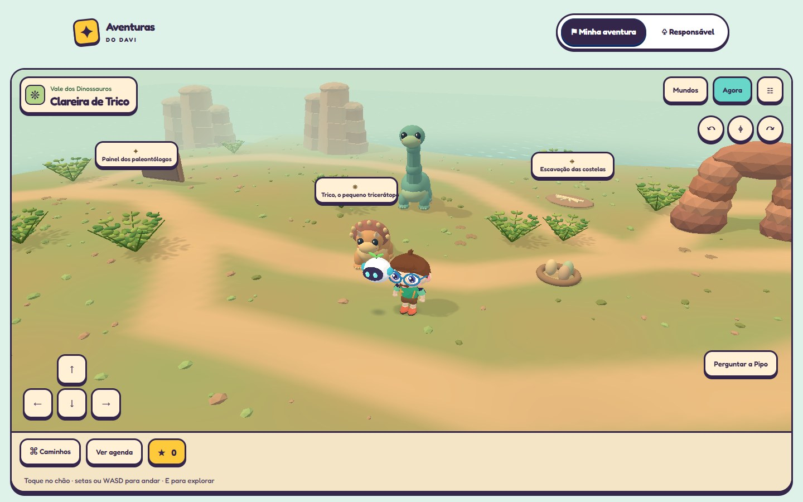 | 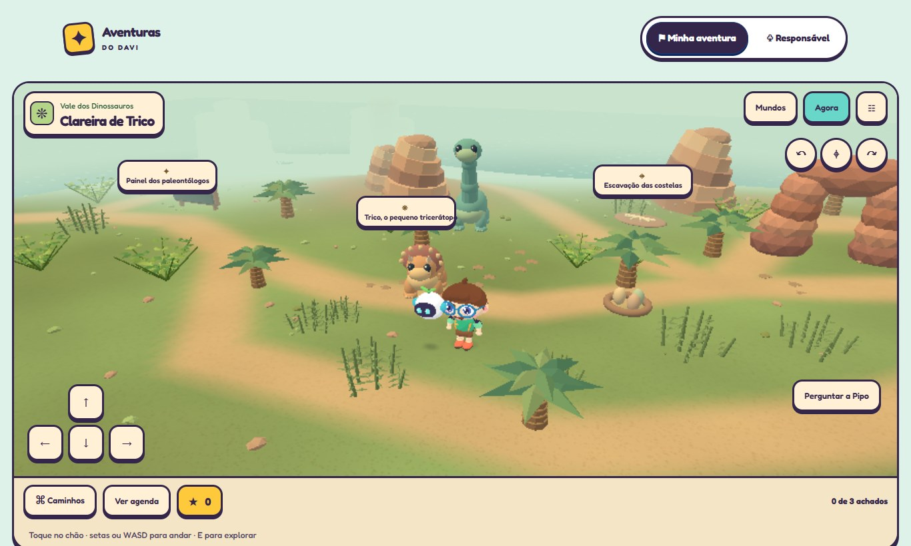 |
| Cidade | 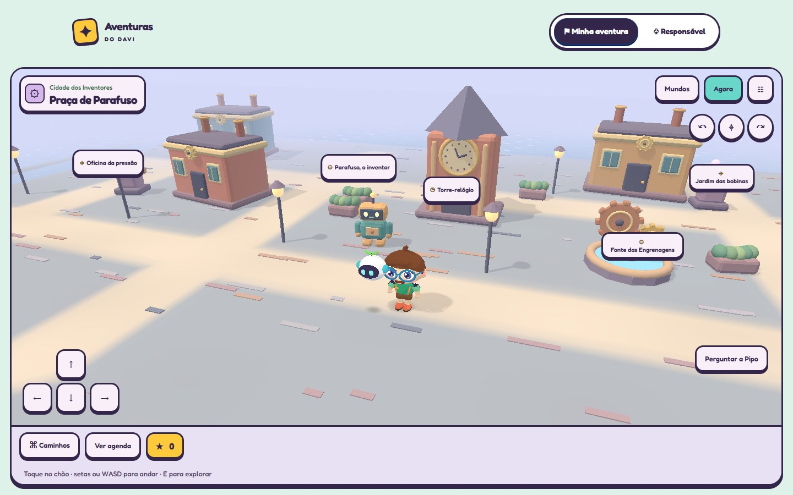 | 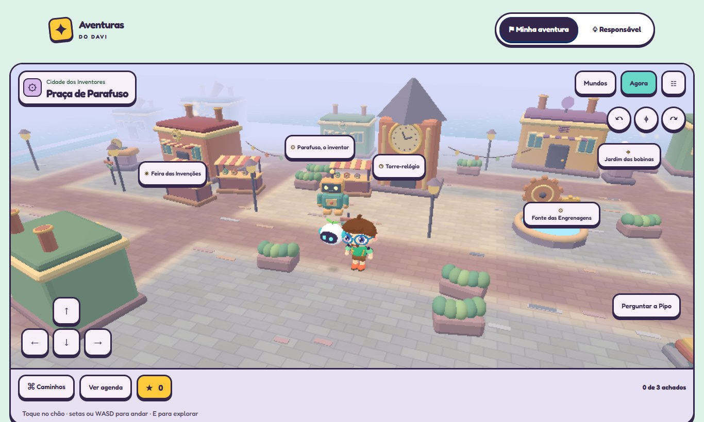 |

## Entradas em tela móvel

| Mundo | Etapa 9 | Etapa 9.1 |
| --- | --- | --- |
| Praia | 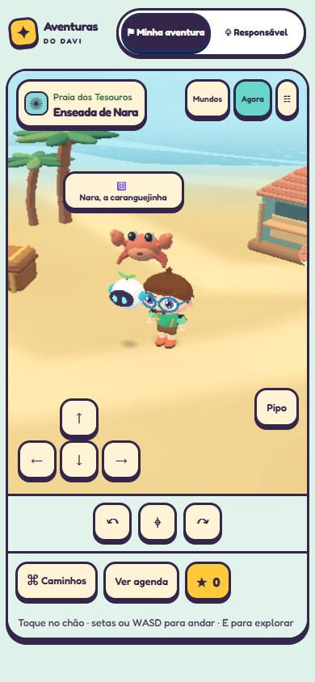 | 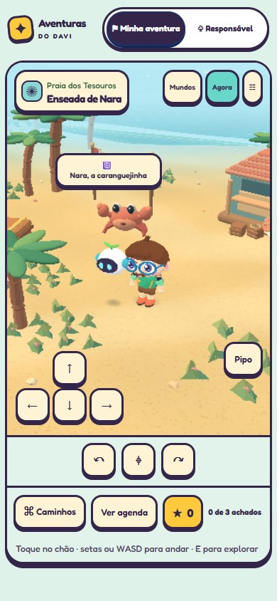 |
| Vale | 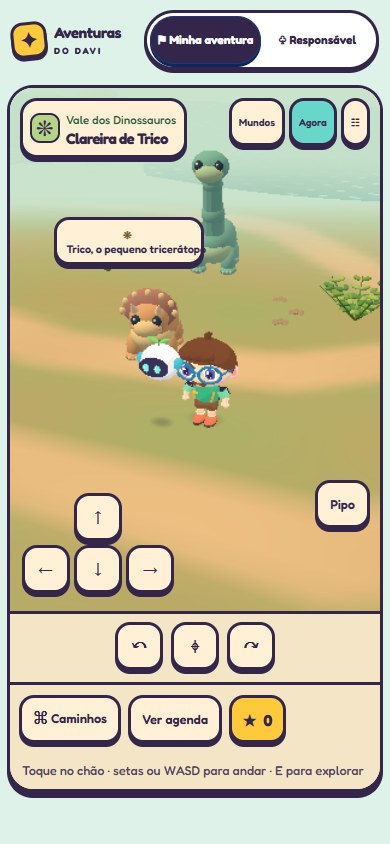 | 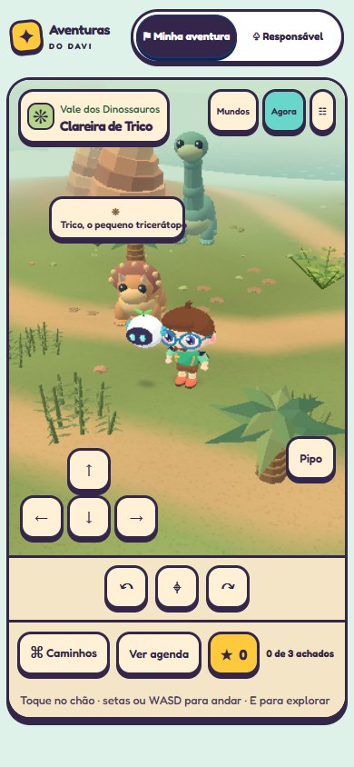 |
| Cidade | 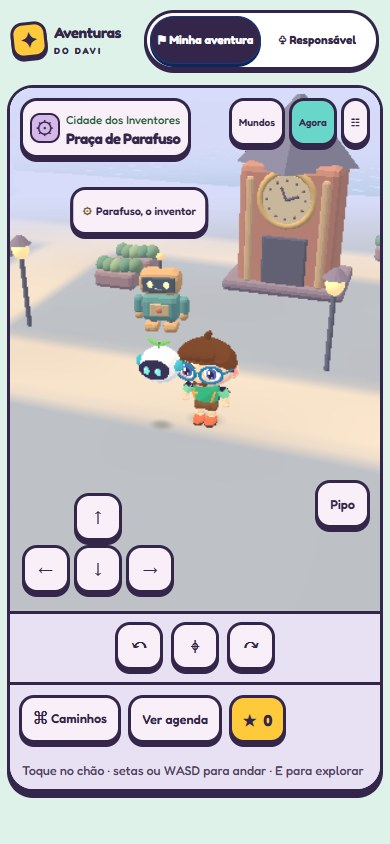 | 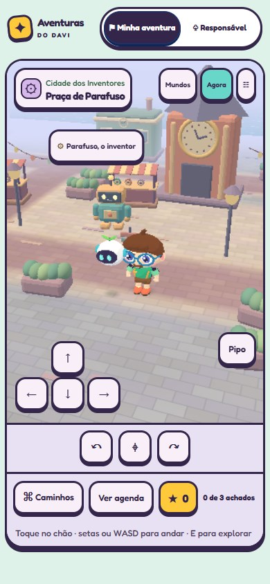 |

## Desfechos

| Mundo | Desktop | Tela móvel |
| --- | --- | --- |
| Praia | [Pérola das Marés](praia-final-desktop.jpg) | [Pérola das Marés](praia-final-mobile.jpg) |
| Vale | [Painel de fósseis](dinossauros-final-desktop.jpg) | [Painel de fósseis](dinossauros-final-mobile.jpg) |
| Cidade | [Autômato](inventores-final-desktop.jpg) | [Autômato](inventores-final-mobile.jpg) |

## Renderização

Contagens lidas do Three.js na entrada de cada mapa depois de 24 quadros em cada perfil. O perfil Detalhado inclui as passagens de sombra. A coluna móvel usa o perfil Econômico. As medições são do Chromium em renderização por software.

| Mundo | Econômico desktop | Detalhado desktop | Econômico móvel |
| --- | ---: | ---: | ---: |
| Praia | 82 chamadas · 152.018 triângulos | 152 chamadas · 303.246 triângulos | 62 chamadas · 112.886 triângulos |
| Vale | 74 chamadas · 117.692 triângulos | 149 chamadas · 221.476 triângulos | 55 chamadas · 98.932 triângulos |
| Cidade | 81 chamadas · 135.916 triângulos | 166 chamadas · 274.716 triângulos | 48 chamadas · 101.768 triângulos |

O roteiro `tools/forest/record_worlds.py` percorre os mapas pelos controles do aplicativo e confere a navegação do Davi e do Pipo, o progresso da aventura, o saldo, o inventário e a retomada do ponto salvo.
