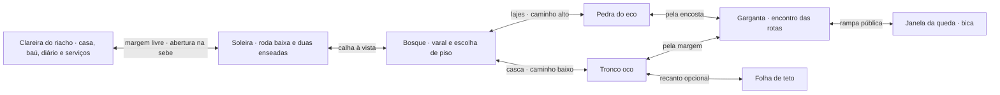

# A floresta que responde

**Etapa 4 · Proposta de game design para o responsável**

Na volta para casa, Davi encontra uma folha presa na margem que estava seca quando saiu. Foi ele quem virou a bica lá em cima. Pode voltar para testar sua ideia, mostrar a folha a alguém ou entrar em casa e guardar a mochila. A floresta ganha vida quando a criança reconhece que duas coisas que viu em lugares diferentes têm relação.

A Etapa 3 demonstrou a roda baixa, duas rotas caminháveis, o avesso da folha, a pedra do eco e o reencontro na garganta. O filme de 56 segundos demonstra que o circuito fecha. A vontade de voltar ainda é uma pergunta para a criança. As ligações espaciais e as três brincadeiras abaixo são propostas para aprovação. [Visão das duas rodas](visao-aventuras-davi.md) · [Percurso e evidências em a1ebd45](https://github.com/nellipe/davi-missoes/tree/a1ebd45/docs/evidencias-etapa3) · [Revisão do orquestrador](https://github.com/nellipe/davi-missoes/pull/17#issuecomment-6977703882)

## 1 · Uma floresta em que se pode voltar a pé

A clareira conhecida continua sendo o endereço de casa. Na margem acessível desde o início, a borda do caminho do diário acompanha o riacho, passa por uma abertura na sebe e chega ao lado de baixo da roda. Da clareira, a criança vê uma pá aparecer e desaparecer nessa abertura. Da soleira, olhando de volta, vê o telhado conhecido por cima da sebe. Esse par de vistas é a costura entre os dois lugares. Davi percorre o trecho inteiro sob o mesmo comando. A roda marca um lugar de passagem e descanso.

Todas as ligações desenhadas são percorríveis nos dois sentidos. O veio de água da janela reaparece nas duas enseadas da soleira, visíveis a poucos passos uma da outra. Um cotovelo de rocha oculta a queda na ida. No retorno, a água desce em direção à roda e o telhado reaparece antes da clareira. O Pátio dos Remendos e a Copa da Nascente ficam reservados no desenho maior. A oficina atual já atende a criança na clareira.

| O que já funciona | Como a criança deve reencontrar isso na integração |
|---|---|
| Casa, baú, ponte, oficina, personalização e portal, com compras e equipamentos persistidos | Manter os endereços da clareira, os identificadores e o estado de cada objeto. Quem construiu reconhece sua obra ao voltar. A ponte conserva sua travessia e seu valor. A passagem pela sebe sai da margem gratuita, inclusive em um perfil novo. |
| Diário, calendário, marcadores de missão, agenda e Caminhos | Conservar os acessos e o vínculo a cada ocorrência. Uma atividade sem roteiro permanece na agenda. Caminhos continua disponível para quem o pede. |
| O protótipo escolhe o cenário por dois botões e guarda posições distintas da clareira e da trilha | Substituir a escolha de cenário pela passagem a pé. Usar um mapa contínuo e um único ponto de retomada da floresta, com posição e marco próximo. Manter a referência espacial da clareira e encaixar a trilha a partir da roda. Na primeira visita integrada, interpretar o ponto antigo conforme o último lugar conhecido no aparelho. Se faltar essa indicação, usar o ponto válido da clareira. Se o ponto não couber no terreno, retomar no marco seguro do mesmo trecho. Validar antes de gravar. |
| Ilha 2D, qualidade econômica e recuperação de WebGL | Representar clareira, sebe, roda, garfo e reencontro com a mesma vizinhança em planta. Ao trocar de visão, conservar a margem e o trecho percorrido. Ter uma única simulação ativa. Os sinais que importam são silhuetas grandes, superfícies e poses estáticas que também cabem no 2D. |

**Prova futura de continuidade.** Em perfis sintéticos, começar uma vez com ponte e casa construídas e outra com inventário vazio. Caminhar do diário ao varal e voltar, alternar 2D na casca e recarregar nas lajes. Conferir o lugar de retorno, a missão selecionada, construções, saldo e equipamentos. A ligação deve aceitar movimento contínuo de teclado, direcional ou toques sucessivos no chão. Se aparecer um seletor de cenário ou for preciso comprar algo para alcançar a roda, a costura precisa de revisão.

## 2 · Três maneiras de descobrir

As três brincadeiras usam verbos diferentes. Uma nasce de observar um morador, outra de experimentar com a água, e a terceira de caminhar até que duas vistas façam sentido juntas. Cada uma cabe numa parada curta e permite passar direto.

### A · Quem mora sob a folha? — observar e experimentar

No recanto da casca, uma folha prateada parece andar. Duas patinhas aparecem sob a ponta e recolhem a folha até a boca do tronco. É um pequeno besouro que usa folhas como telhas. A abertura continua larga o bastante para que a dupla veja o abrigo da trilha. Perto do tronco há uma segunda folha grande com uma dobra no meio. Tocar a dobra vira a folha sobre uma forquilha, gesto que também aceita a ação local por teclado. Como canaleta, ela deixa a goteira pingar numa poça. Como telhado, abriga um retalho seco. O besouro se acomoda sob esse retalho ou debaixo da casca, onde já tem abrigo.

**Experiência opcional completa.** Davi vê as patinhas da rota baixa. Pode seguir andando. Se entrar no recanto, vê a goteira acertar o chão e o besouro puxar uma ponta de folha. Ao virar a dobra, vê primeiro a gota mudar de lugar, depois o besouro arrastar a telha até o novo canto. Pipo levanta uma orelha e se abaixa ao lado de Davi, deixando a entrada livre. Ao sair e voltar pela mesma casca, a ponta prateada continua no canto escolhido. Uma nova virada permite testar o outro abrigo. Mesmo chegando depois da animação, a poça, a folha e as patinhas deixam a consequência legível. A brincadeira termina bem se a criança só parar para olhar.

Guardar apenas a posição da folha. O abrigo e a pose do besouro derivam dela, inclusive depois de recarga ou de uma missão. No perfil econômico e com movimento reduzido bastam duas poses e as duas marcas de goteira. O besouro está sempre seguro e pode ser observado nas duas posições.

### B · Para onde vai meu barco? — mudar algo aqui e reconhecê-lo adiante

Na janela da garganta, um barquinho de ponta dobrada encosta numa bica em forma de Y. A criança alcança a lingueta de madeira pelo lado da rampa. Um toque a faz assentar à esquerda ou à direita. A boca escolhida escurece com a água, a outra seca e um barco de mesma ponta dobrada sai por ali. O primeiro resultado já cabe no quadro da janela.

Na soleira, um braço alimenta a enseada junto à pá da roda e o outro passa por baixo de uma raiz arqueada. A água deixa um barco encostado no junco da enseada escolhida. A criança pode comparar as duas margens a pé, subir para inverter a lingueta ou deixar o riacho como está. O efeito distante fica à espera dela, mesmo que abra Agora ou volte outro dia. Guardar o lado da lingueta basta para recompor água e barco. Vários toques atualizam uma só configuração. Nenhum barco é consumido, acumulado ou recolhido no inventário.

### C · A garça de pedra — mudar o próprio ponto de vista

Na subida das lajes, a borda de uma pedra lembra um bico e um veio branco na parede oposta parece uma asa solta. Uma laje larga com reentrância convida Davi a sair um passo da trilha. Ao caminhar por essa faixa, bico, asa e reflexo se aproximam até formar a silhueta de uma garça pousada. A separação volta a aparecer quando ele caminha mais um pouco. A criança pode investigar o que desenha cada parte ou mostrar o lugar a Pipo. A garganta continua acessível pela borda da laje.

A faixa de alinhamento deve aceitar alguns passos e toda a largura de Davi. A vista habitual, o toque e o direcional bastam. Da rota baixa vê-se o veio na rocha, o que dá outro sentido a uma segunda passagem. A silhueta se recompõe toda vez pela posição de quem olha. Nenhum estado precisa ser salvo. No 2D, sobrepor os mesmos três contornos por paralaxe ao andar nessa faixa. Com movimento reduzido, usar a silhueta composta no trecho central e as partes separadas nas duas bordas.

## 3 · Como Pipo faz companhia

| Situação | Gesto e espaço da criança |
|---|---|
| Chegada ao varal | Para ao lado de Davi e ajeita o lenço sob o pano. Os dois pisos ficam livres. Só entra numa das rotas depois de Davi escolher. |
| Algo se mexe no recanto | Quando Davi se vira para a folha, Pipo baixa o corpo para olhar por baixo. Se Davi vai embora, Pipo levanta e acompanha. |
| A bica muda ou a garça aparece | Na bica, segue o barco com a cabeça até ele desaparecer. Na laje, inclina a cabeça junto de Davi e volta a descansar. Uma reação por mudança ou aproximação basta. Parar no lugar não dispara falas repetidas. |
| Retorno | Perto da enseada alterada, Pipo observa a ponta dobrada que reapareceu. No caminho de casa, sacode a água das patas ao deixar a margem. São gestos curtos que não interrompem o controle. |
| A criança pede ajuda | Uma pista observável por pedido. No tronco, “Vi duas patinhas debaixo da ponta”. Na volta, “A água desce para a roda”. Oferecer texto curto e voz se habilitada. A criança decide se usa a pista. |

Pipo acompanha a velocidade e o lado livre de Davi. Em pausa, tarefa ou retorno, espera o próximo movimento da criança. Seus gestos enriquecem descobertas que continuam legíveis com som desligado e com o companheiro fora do quadro.

## 4 · Fazer a escolha caber na tela da criança

Em 1366 px, o varal enquadra a casca e as lajes formam uma diagonal longa. Em 390 px, o poste e a borda esquerda cortam a continuidade da casca. Em 360 px, a mensagem de Pipo também ocupa parte da vista. A correção começa no chão antes do varal. [360 px](../evidencias-etapa3/bifurcacao-360.png) · [390 px](../evidencias-etapa3/bifurcacao-390.png) · [1366 px](../evidencias-etapa3/bifurcacao-1366.png)

1. Fazer a calha chegar pelo meio de uma pequena abertura triangular. No seu vértice, ainda antes de se comprometer com um braço, Davi vê duas entradas próximas olhando para a frente. Os caminhos se afastam **depois** desse primeiro trecho.
2. Recuar o varal para a ilha de vegetação entre os braços. À esquerda, três travessas largas conduzem a um arco baixo de casca. À direita, duas lajes largas sobem até uma pedra com um rasgo de céu. Altura, contorno e textura distinguem os lados em escala de cinza. A ilha esconde a junção e a queda.
3. Com o enquadramento padrão de aproximação, manter os pés no terço inferior e os dois primeiros trechos livres na faixa central da área de jogo. Cada entrada oferece uma área contínua de chão tocável de pelo menos **44 × 44 px CSS**, inclusive com Agora, direcional e ajuda visíveis. As pistas solicitadas ocupam espaço fora dessas duas áreas. A orientação manual da câmera segue sob controle da criança.
4. Na volta, o verso do pano e a calha que desce para a roda são visíveis de ambos os braços. A criança pode reconhecer o reencontro mesmo se não lembrar qual lado escolheu na ida.

**Ensaio para o futuro protótipo.** Em 360 e 390 px, registrar o primeiro quadro de decisão, em perfil econômico, com som desligado e câmera padrão. Em cada largura, tocar diretamente cada um dos pisos em passagens diferentes e conferir a chegada ao braço escolhido. Repetir com a ajuda aberta e com movimento reduzido. Depois, observar se a criança percebe as duas opções antes de caminhar, sem pedir que gire a câmera. Se só vir as lajes, ajustar a aproximação e o piso e repetir o ensaio. Uma placa explicativa não resolve esse diagnóstico.

## 5 · Uma atividade da vida real pode começar a qualquer momento

**Agora** fica a um toque em cada margem, inclusive no recanto e em 2D. Com uma ocorrência aberta, vai à ficha. Com várias, permite escolher. Uma ocorrência sem roteiro continua acessível. Com compromisso futuro ou dia livre, a criança vê o próximo horário ou a agenda. Fechar devolve Davi à mesma margem e conserva a folha ou a bica na posição escolhida.

Aprender e Lembrar conservam suas formas de prática. Fazer mantém os passos e a validação de confirmação ou desfazimento pelo servidor. Agenda, economia e permissões continuam sob controle do responsável. A exploração pode começar com a agenda vazia, saldo zero e ponte por construir. Virar a folha, observar o besouro, alinhar a garça ou sair no meio da volta não afeta a rotina. As descobertas estão disponíveis em qualquer visita, sem prazo, série diária, sorteio ou prêmio.

## 6 · Como saber se dá vontade de voltar

Usar duas oportunidades breves e voluntárias em dias convenientes para a família, com agenda sintética livre. Na primeira, oferecer o aparelho com “Você pode brincar aqui ou parar quando quiser”. Observar em silêncio o primeiro gesto e o que chamou a atenção. Na segunda, deixar a criança escolher se quer voltar à floresta. Se voltar, esperar sua primeira decisão antes de perguntar “O que você quis ver de novo?”. Aceitar apontar, refazer um gesto ou conduzir o adulto até um lugar como resposta. Registrar largura de tela, lugar, ação concreta, ajuda pedida e palavras espontâneas. Tempo de tela e circuito completo não são metas.

| Pergunta para o responsável | Evidência favorável | O que pede revisão |
|---|---|---|
| A floresta é um lugar só? | Sai do lugar conhecido, chega à roda e reconhece um marco para voltar a casa. | Procura um botão para trocar de jogo ou fica presa por uma construção. |
| Há escolha em retrato? | Antes de seguir, consegue apontar os dois pisos ou mostrar o outro caminho quando perguntada depois. Confirmar nas duas larguras. | Só percebe a casca após indicação adulta, giro obrigatório ou leitura de Pipo. |
| O mundo respondeu a uma ideia dela? | Por iniciativa própria, repete com uma variação, prevê a outra posição ou mostra onde o efeito reaparece. | Vê a animação, mas não consegue relacionar o gesto ao que mudou, mesmo podendo testar de novo. |
| Quis explorar outra vez? | Em outra oportunidade, escolhe voltar e procura um detalhe, testa uma hipótese ou leva alguém a um lugar que lembra. Anotar qual. | Após oportunidades tranquilas, só repete instruções do adulto ou pergunta o que vai ganhar. Rever a consequência ou a pista. Uma visita recusada ou interrompida deixa a questão em aberto. |
| A rotina continua autônoma? | Num ensaio separado com uma ocorrência sintética aberta, acessa Agora no meio da brincadeira e retorna ao mesmo ponto. | Precisa concluir a descoberta, atravessar a ponte ou recuperar uma alteração perdida. |

**Decisão desta rodada.** Aprovar ou pedir ajustes na ligação pela sebe, na composição do garfo em retrato e nas três situações de descoberta. Para uma primeira prova, a folha de teto concentra encontro, escolha, consequência e revisita em um único recanto que já existe. A bica é a candidata se a pergunta priorizada for a memória entre dois lugares. A garça testa a leitura do relevo com o menor estado persistente. Cabe ao responsável escolher uma delas. Observação infantil e avaliação nos aparelhos físicos continuam pendentes.
