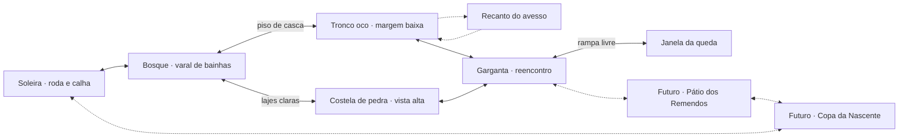

# Aventuras do Davi · A floresta das duas rodas

**Direção narrativa aprovada · Etapa 3 · Arquitetura do percurso em revisão**

Uma roda de madeira gira ao lado da soleira onde Davi deixa a mochila. De vez em quando, uma folha em forma de canoa chega pela calha e passa sob a roda. Pipo tenta acompanhá-la com a cabeça. Davi pode abrir sua atividade ali mesmo ou seguir a calha *contra* a corrente. De onde vêm os barcos de folha?

A resposta se encontra acima das copas. Uma segunda roda recolhe folhas caídas e as solta, uma a uma, na nascente. A criança consegue entender a floresta como um lugar inteiro quando reconhece, lá em cima, a folha que viu partir lá embaixo. Se voltar outro dia, o pequeno mecanismo continua funcionando, inclusive em um dia de agenda vazia. **É essa a fantasia central**: ser um explorador que descobre como um lugar vive, com um companheiro que também tem coisas a aprender.

## De onde partimos

| Evidência do projeto | Consequência para esta proposta |
|---|---|
| O produto foi pensado para crianças de 8+ anos, com um passo por vez, prática curta, ajuda ajustável e passagem da tela à vida real. A agenda, os modos Aprender/Fazer/Lembrar, as estrelas e os controles do responsável já existem. | A atividade real pode interromper qualquer descoberta. Sair no meio do caminho é um fim de sessão válido. |
| A ilha 2D já oferece diário, calendário, oficina, personagem, ponte, casa e portal. A PR #17 tem Davi e Pipo animados, uma clareira 3D, construções e uma primeira distribuição de estações e marcadores de atividade. A Etapa 2 validou os dez destinos no navegador desktop. | Preservar o que a criança consegue fazer, mas reorganizar onde e como encontra cada coisa. |
| Na prévia de 1366 px, baú, oficina, diário, ponte e casa são identificáveis por etiquetas no mesmo quadro. A 360 px, a etiqueta da ponte compete com o personagem. Na referência original, vemos a entrada da ponte, um trecho de água muito abaixo e uma saída encoberta. A posição do observador muda o que se pode saber. | Usar o relevo para separar destinos. Reservar nomes para o lugar próximo ou para a orientação solicitada. A composição precisa funcionar também com som e etiquetas desligados. |
| A família relatou flutuação e perda de referência ao alternar 2D/3D. A Etapa 2 estabilizou movimento, apoio e troca de visão em 30 ciclos no desktop. | Uma revelação depende da caminhada voluntária e do ponto de vista da criança. A câmera nunca toma o controle para apresentar um lugar. |

As cinco regiões e o mistério são **direção aprovada**. O protótipo da Etapa 3 materializa a roda baixa, o varal, as duas trilhas, o avesso da folha, o eco e a janela da queda. Os endereços pedagógicos futuros por região, o diário de lugares visitados, a travessia entre regiões 3 e 4 e a roda alta continuam propostos. As capturas documentam a versão anterior a esse design. Bases consultadas: [produto e missões](../PRODUTO-E-MISSOES.md), [README](../../README.md), [Issue #16](https://github.com/nellipe/davi-missoes/issues/16), [Issue #18](https://github.com/nellipe/davi-missoes/issues/18), [PR e comentários do responsável](https://github.com/nellipe/davi-missoes/pull/17), [relatório e capturas](../issue18-progresso.md). A imagem local `D:\davi-missoes\docs\modelo.png` foi consultada como referência de composição.

## Mapa de direção

A primeira volta cabe entre três lugares. No bosque, a criança pode baixar até a madeira escura ou subir pela pedra clara. Do entroncamento da garganta, a outra trilha é também um caminho de volta. O miolo de vegetação e pedra impede cortar de uma escolha para a outra pelo centro.

As linhas contínuas descrevem o circuito deste protótipo. O recanto é opcional. Pátio e Copa ficam para uma decisão posterior. No desenho futuro, a ponte comprável encurta uma travessia já acessível por terra e a escada da Copa fecha outra volta até a Soleira.

## Os primeiros cinco minutos

| Momento da sessão livre | Escolha e descoberta |
|---|---|
| Chegada | Parar ao lado da roda e esperar um barquinho passar, abrir Agora ou seguir a curva da calha. A sebe e o cotovelo de pedra encobrem o fundo do vale. |
| Primeira escolha | O pano suspenso marca o bosque. À esquerda o chão escurece e desce até a casca. À direita lajes claras sobem pelo ombro da rocha. É possível dar meia-volta logo depois de escolher. |
| Uma pequena investigação | Pela esquerda, entrar no recanto ao lado do tronco e virar uma folha para ver o avesso. Pela direita, acordar o eco junto às pedras e observar o vale de cima. As duas decisões permitem seguir adiante. |
| Retorno ou continuação | Quem chega à garganta pode olhar pela janela da queda e voltar pelo outro piso. Quem fica junto à roda também completou uma pequena história. A pergunta sobre a origem dos barquinhos fica aberta para outro dia. |

Cinco minutos são uma oportunidade de escolher, observar e reconhecer o caminho de volta. A criança pode gastar a sessão inteira comparando duas folhas. O relevo e as mudanças de perspectiva dão escala sem impor distância ou tempo mínimo.

### O que convida a voltar

Na segunda visita, é possível percorrer o circuito no sentido inverso. O arco escuro que escondia a folha passa a emoldurar a saída, e as pedras que convidavam a subir formam degraus reconhecíveis na descida. A roda recebe outro barco enquanto Davi está perto. Virar a folha outra vez muda a face exposta, e bater na pedra repete o eco visível. São brincadeiras reversíveis, disponíveis em dia livre. Pipo reage à proximidade e à investigação. A ajuda depende de um pedido da criança. No futuro, a roda alta dará uma explicação à água que já se conhece daqui de baixo. Mesmo depois dessa explicação, permanecem os dois pontos de vista, os gestos e o prazer de mostrar a alguém o caminho escolhido.

## Como se vive em cada região

| Região e assinatura artística | O que se faz ali | O que fica escondido e como se revela |
|---|---|---|
| **1. Soleira da Roda Baixa.** Luz de manhã, lona azul, madeira clara marcada pela água. A roda é baixa o suficiente para Davi pôr a mão ao lado de uma pá. | Pendurar a mochila abre a preparação para escola ou saída. As páginas datadas no banco dão acesso ao calendário e ao diário completo. A água continua trazendo folhas quando não há compromissos. | Da soleira vê-se a água entrando por baixo da sebe. Nem a nascente nem a oficina entram no quadro inicial. A abertura lateral convida a investigar. |
| **2. Bosque das Bainhas.** Troncos finos, luz em faixas e folhas compridas que se dobram como tecido. Um lenço no varal distingue o lugar mesmo em silhueta. | O varal é o lugar de experimentar capa, chapéu e lenço de Pipo. Uma cesta de pano pode acolher a preparação de roupa para um passeio. Por trás de um tronco oco, a mesma folha parece escura de um lado e prateada do outro. | As duas trilhas levam à garganta. Só a investigação do avesso exige sair do caminho, ao lado do tronco. |
| **3. Garganta das Duas Margens.** Rocha em camadas, eco e um intervalo de céu entre duas paredes. A primeira vista enquadra a margem próxima, o corrimão ou seus encaixes e a espuma ao fundo. | Escolher como atravessar. A rampa contorna a parede em dois lances curtos. Construir a ponte cria uma travessia mais direta, com Davi e Pipo lado a lado. Sob a saliência há uma janela de onde a queda parece sair de dentro da pedra. | Antes da curva, vê-se espuma, mas a queda só aparece por inteiro no desvio. Na saída, as aparas anunciam o pátio sem revelar sua bancada. |
| **4. Pátio dos Remendos.** Cor de barro, bancada gasta, ferramentas com um lugar próprio. O ritmo de uma peça de madeira batendo no batente contrasta com o som contínuo do rio. | A bancada abre a oficina com preço e prévia. A prateleira vazia corresponde à missão de organizar. Ao lado, um arco de galhos acomoda o portal construído para praticar os jogos. Sem atividade, mudar de posição revela que dois pedaços de madeira separados formam a silhueta de um pássaro. | O muro protege o pátio da vista da garganta. A calha que passa sobre a bancada conduz o olhar a uma escada. O tronco encobre o topo da escada. |
| **5. Copa da Nascente.** Copa aberta, pano de vela, água que reluz devagar. Uma bica move a roda alta. Cada pá é larga como uma folha. | Assistir ao nascimento dos barquinhos. O ninho de leitura na plataforma acolhe a preparação para o descanso. A casa construída acrescenta um refúgio mobiliado. O poleiro atrás da roda oferece uma pausa para observar aves pousarem. | A roda alta só se revela no último quarto de volta em torno do tronco. Uma abertura estreita na folhagem aponta de volta à roda baixa. O restante da floresta continua parcialmente oculto. |

**Descobertas obrigatórias de composição.** O percurso principal deve oferecer a folha que chega, a escolha de margem, a oficina anunciada pelas aparas e a origem da folha na roda alta. “Obrigatória” é uma obrigação de quem desenha o percurso. Nenhum desses encontros exige clique, leitura, compra ou registro de conclusão para avançar.

**Descobertas opcionais.** O avesso prateado das folhas ensina a olhar de outro ângulo. A janela da queda convida a seguir a espuma. A silhueta de pássaro no pátio depende do ponto de vista. O poleiro pede apenas uma pausa. Todos voltam a acontecer. A criança pode partir antes do fim, voltar mais tarde ou nunca encontrá-los.

## Onde a vida real entra

**“Agora” fica a um toque em qualquer região**, inclusive na exploração em 2D. Abre diretamente a ficha da ocorrência do momento, com horário, nome e ação adequada. Com várias ocorrências simultâneas, abre a lista curta das disponíveis. Sem atividade aberta, mostra o próximo horário ou “Dia livre” e oferece a agenda. Fechar devolve a criança ao lugar de onde saiu. Durante uma atividade fora da tela, Davi e Pipo esperam.

No mundo, a mesma ocorrência ganha um endereço estável por finalidade. A mochila da soleira serve a “Preparar a mochila”, a cesta do varal a “Separar o uniforme” e a prateleira da oficina a “Guardar meus materiais”. O responsável pode escolher o lugar ao vincular uma atividade. Uma atividade nova sem endereço fica no diário da soleira. Várias no mesmo destino compartilham o objeto e aparecem por horário só quando a criança o examina. Uma agenda com vinte atividades continua produzindo cinco regiões legíveis.

Uma ocorrência sem roteiro mostra descrição, horário e acesso à agenda. Com roteiro, Aprender e Lembrar oferecem prática. Fazer apresenta passos e respeita a janela da PR #14 para confirmar ou desfazer. A agenda mantém a confirmação do compromisso separada dos passos. Descobrir a nascente, jogar, comprar ou atravessar nunca confirma uma tarefa. Cuidados pessoais podem ser preparados em privacidade e realizados longe do aparelho. Os controles do responsável continuam sendo a autoridade para horários, vínculos, correções e economia.

## Pipo, câmera e orientação

Pipo é um parceiro pequeno o bastante para enxergar por baixo da calha que Davi vê de cima. Na soleira, ele estica a mão tarde demais e olha para Davi. Na garganta, espera junto à entrada da rampa. Na copa, olha da pá para o vale e deixa a criança fazer a ligação. Esses três gestos contam a história com o som desligado. Pipo acompanha a escolha de Davi, ocupa o lado livre da trilha e para ao lado dele. Uma ajuda solicitada oferece uma frase concreta por vez: “A água vem de trás da sebe”. Pode ser repetida em texto ou voz.

- **Orientação espontânea.** A água é a referência longitudinal. Subir contra a corrente leva à origem. Na volta, seguir a água leva para casa. Cada bifurcação oferece uma pista visível, uma diferença de piso e um marco reconhecível olhando nos dois sentidos. O som é uma pista adicional.
- **Orientação solicitada.** “Onde estou?” mostra uma página do diário com o desenho do lugar atual, o último marco conhecido e os lugares já visitados. “Voltar à soleira” oferece retorno imediato. O atalho “Agora” funciona inclusive antes de a criança conhecer o destino correspondente.
- **Câmera.** Vista oblíqua próxima, com os pés e o próximo trecho de chão visíveis. Na curva da garganta, a rocha sai do primeiro plano pelo movimento de Davi. A câmera só acompanha. Se uma copa encobrir Davi ou o ponto de toque, ela perde opacidade. Girar e recentralizar são escolhas da criança. Em retrato, preservar a faixa caminhável e a dupla no quadro vale mais que mostrar a paisagem inteira.
- **Controles.** Toque em chão visível escolhe o destino, setas na tela e teclado movem em relação ao enquadramento. Ao chegar perto de um objeto surge uma ação local com verbo concreto, como “Abrir a mochila”. Tocar fora da trilha conserva a posição segura e dá uma pista breve. Pausa, retorno da missão e troca 2D/3D retomam sem impulso anterior.
- **Acessibilidade e custo.** Com movimento reduzido, os enquadramentos ficam estáveis e a folha aparece em posições de partida e chegada reconhecíveis. Os símbolos da roda, do varal e da bancada têm forma e nome próprios. Na qualidade econômica, silhueta, oclusão e contraste do chão sustentam cada revelação. O equivalente 2D oferece os mesmos destinos, tarefa imediata e retorno seguro.

## Quatro mundos que podem vir depois

Cada mundo futuro herda Davi, Pipo, o diário e o acesso a “Agora”. Cada um merece uma pergunta explorável própria. São possibilidades para depois da aprovação da Floresta, na ordem a decidir com a família.

| Mundo previsto na Issue #16 | Pergunta que sustenta uma visita em dia livre | Gesto próprio e aplicação possível à rotina |
|---|---|---|
| Ilhas das Nuvens | Para onde vai a sombra de uma nuvem quando some do chão? | Comparar a sombra entre duas ilhas revela um jardim suspenso. Um ponto de partida abriga a preparação para sair. |
| Cidade dos Robôs | Quem responde ao toque do sino da estação? | Seguir uma sequência de movimentos entre oficinas revela dois autômatos que se cumprimentam. A bancada acolhe ordenar e guardar materiais. |
| Ilha dos Tesouros | O que a maré baixa deixou desenhado na areia? | Observar o mesmo recife de duas enseadas revela uma figura inteira. Uma mesa de viagem acolhe conferir itens da mochila. |
| Montanhas de Cristal | Por que uma pedra canta mais baixo que a outra? | Mudar de galeria altera o eco e o desenho da luz. Um abrigo silencioso acolhe uma sequência de descanso. |

## Como avaliar o protótipo

Começar na Soleira e deixar a criança escolher onde olhar e quando parar. Na volta, perguntar por onde ela passou e qual caminho tentaria numa próxima visita. Os tempos abaixo são medidas de projeto para o adulto, nunca metas para a criança.

| Ensaio de design | Aprovar quando | Pedir revisão quando |
|---|---|---|
| Primeira vista em três larguras de tela, 360, 390 e 1366 px | Há um marco dominante, chão livre e uma pista para o próximo trecho em cada quadro. | Dois ou mais destinos distantes se identificam por etiquetas, ou um controle cobre a dupla ou a trilha. |
| Caminhada em dia livre, sem estrelas | A criança escolhe ao menos um desvio ou indica espontaneamente algo que quer investigar. Consegue indicar um detalhe que mudaria se voltasse pela outra trilha. | Precisa de instrução a cada curva, de um prêmio para seguir ou de explicação adulta para reconhecer o reencontro das duas trilhas. Rever a pista, sem atribuir a dificuldade à criança. |
| Percurso e proporção | A criança consegue distinguir os dois caminhos pelo piso e pelo marco, encontrar o reencontro e reconhecer a entrada na volta. | Um segmento só acrescenta espera, as duas vistas parecem iguais ou uma compra impede a volta. |
| Interrupção em três situações sintéticas: atividade aberta, futura e sem roteiro | Em cada região, um gesto abre “Agora”. Em até dois gestos chega-se à ficha desejada. A ficha apresenta a ação correta e permite sair para a vida real. | Uma tarefa exige andar, estrelas ou completar um roteiro. Uma atividade desaparece ou uma descoberta dá baixa nela. |
| Volta e acessibilidade | Saindo da garganta, a criança reconhece um marco de volta, ou encontra a ajuda por iniciativa própria. A mesma escolha é compreensível com som desligado, sem distinguir cores e em quadro estático. | É necessário ouvir Pipo, ler várias placas de uma vez ou acompanhar um giro automático para saber para onde ir. |
| Julgamento do responsável | O responsável identifica um lugar que gostaria de revisitar com Davi e aprova expressamente o mapa, as escolhas e o ritmo observados. | A resposta continua sendo “parece um menu”. Nesse caso, redesenhar primeiro a passagem entre soleira e garganta, antes de investir nos cinco cenários. |

**Decisão da Etapa 3.** Jogar da Soleira até a Garganta e voltar. A criança reconhece o bosque, percebe as duas opções, encontra algo por iniciativa própria e sabe pedir ajuda ou abrir Agora? O responsável decide se o mapa e o ritmo merecem avançar. A próxima etapa exige aprovação explícita. [Revisão do orquestrador](https://github.com/nellipe/davi-missoes/pull/17#issuecomment-6977127539).
